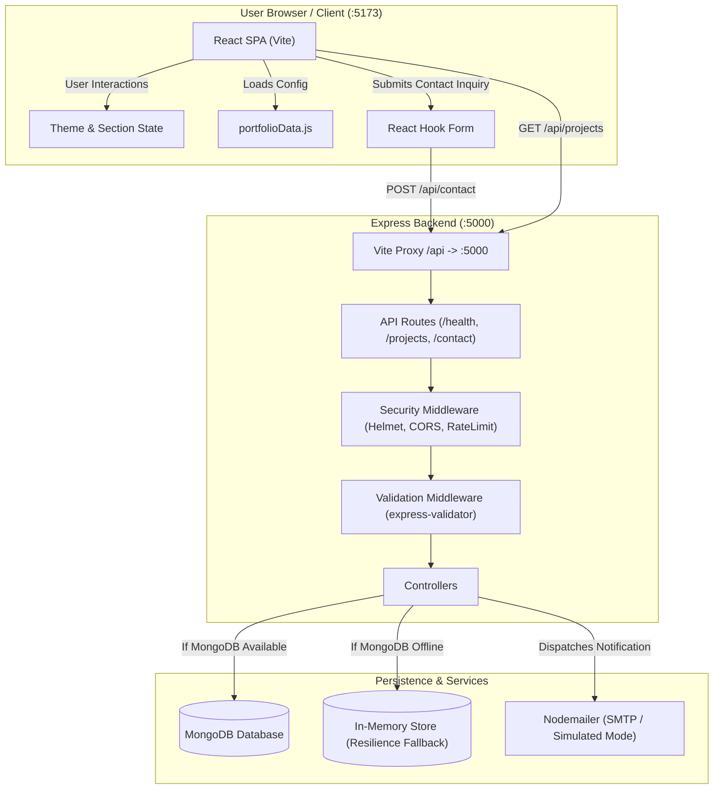
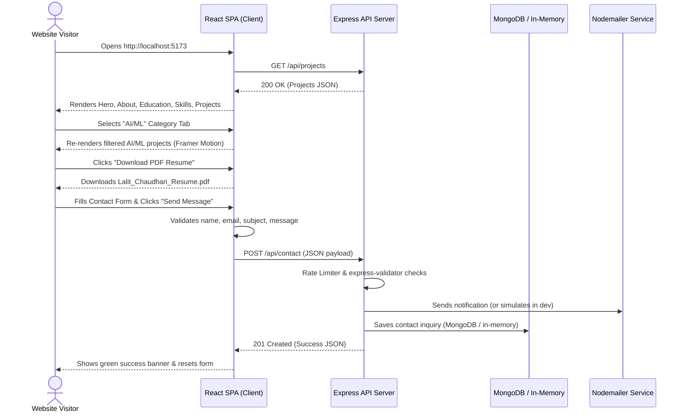

# Project Documentation: Personal Portfolio Website

This document provides complete, verified technical documentation for the Personal Portfolio Website codebase in this repository. All details documented below have been directly verified against the actual repository files, source code, and test execution runs.

---

## 1. Project Overview

- **Project Name**: `portfolio-workspace` (Client: `portfolio-client`, Server: `portfolio-server`)
- **Portfolio Owner / Subject**: Lalit Chaudhari (M.Sc. Industrial Mathematics student, AI/ML & Software Developer)
- **Purpose and Objectives**: Deliver a modern, fully functional, responsive, and data-decoupled personal portfolio website. The platform showcases personal background, academic qualifications, technical skills, projects, resume download capabilities, and an active communication channel for contact inquiries.
- **Problem Solved**: Replaces static, hardcoded portfolios with a resilient full-stack architecture that includes dynamic API-backed project retrieval, persistent contact form submissions, dark/light theme persistence, mobile-optimized navigation, and automated verification suites.
- **Target Users**: Recruiters, hiring managers, engineering peers, academic collaborators, and clients seeking details about Lalit Chaudhari's technical background in AI/ML, NLP, Industrial Mathematics, and Full-Stack Engineering.
- **Main Features**:
  - Sticky glassmorphic header with active section scroll-spy and responsive slide-out mobile drawer.
  - Light and Dark mode theme toggling with `localStorage` persistence and system color preference fallback.
  - Hero section with custom monogram avatar, availability badge, action buttons, and direct social links.
  - Comprehensive "About Me" section highlighting academic background, career objectives, learning goals, core strengths, and spoken languages.
  - Chronological education timeline featuring degree, institution, grades, coursework pills, and descriptions.
  - Categorized technical skills explorer organized into 6 tabs with proficiency indicators.
  - Filterable projects showcase with category tabs (`All`, `Web Development`, `AI/ML`, `Other`), direct source code links, live demo links (or graceful offline indicators), and detailed modal view.
  - Verified resume download link serving [`client/public/resume.pdf`](file:///c:/Users/Asus/Desktop/Assignment/Portfolio/client/public/resume.pdf) with preview in browser option.
  - Controlled contact form with React Hook Form validation, backend validation via `express-validator`, IP-based rate limiting, MongoDB persistence (with in-memory fallback), and Nodemailer email alerts.
  - Dynamic footer with auto-updating copyright year, quick links, and a smooth back-to-top button.

---

## 2. Technology Stack

### Frontend (`client/`)
| Technology | Version | Purpose in Project |
|---|---|---|
| **React** | `^18.3.1` | Core UI library for component-based rendering |
| **Vite** | `^6.2.0` | Next-generation frontend build tool and local dev server |
| **Tailwind CSS** | `^3.4.17` | Utility-first CSS framework with `class`-based dark mode |
| **PostCSS & Autoprefixer** | `^8.5.3` / `^10.4.20` | CSS transformations and cross-browser vendor prefixing |
| **Framer Motion** | `^12.4.7` | Declarative animations for entrances and modal transitions |
| **Lucide React** | `^1.16.0` | Icons for navigation, actions, categories, and contact info |
| **React Hook Form** | `^7.54.2` | Controlled form validation and error handling in contact section |
| **clsx & tailwind-merge** | `^2.1.1` / `^3.0.2` | Conditional class composition and utility merging |
| **Vitest & React Testing Library** | `^3.0.7` / `^16.2.0` | Client component and interaction testing in `jsdom` |

### Backend (`server/`)
| Technology | Version | Purpose in Project |
|---|---|---|
| **Node.js** | `>=18` (Runtime: v24.20.0) | JavaScript runtime environment |
| **Express.js** | `^4.21.2` | REST API HTTP web application framework |
| **Mongoose** | `^8.10.1` | ODM for MongoDB schema definition and persistence |
| **Nodemailer** | `^6.10.0` | Email notification service for incoming contact submissions |
| **express-validator** | `^7.2.1` | Server-side request sanitization and schema validation |
| **express-rate-limit** | `^7.5.0` | IP-based request throttling on contact submissions |
| **Helmet** | `^8.0.0` | Security headers middleware |
| **CORS** | `^2.8.5` | Cross-Origin Resource Sharing control between client and server |
| **dotenv** | `^16.4.7` | Loads environment variables from `.env` files |
| **Supertest & Vitest** | `^7.0.0` / `^3.0.7` | HTTP integration testing for API endpoints |

### Monorepo Coordination
| Tool | Version | Purpose in Project |
|---|---|---|
| **concurrently** | `^9.1.2` | Monorepo helper running client and server concurrently via `npm run dev` |

---

## 3. Project Architecture

The application adopts a decoupled client-server architecture with an Express REST API backend and a React (Vite) single-page application frontend.



### Key Interactions:
1. **Frontend Bootstrapping**: React mounts at [`client/src/main.jsx`](file:///c:/Users/Asus/Desktop/Assignment/Portfolio/client/src/main.jsx), loads data from [`client/src/config/portfolioData.js`](file:///c:/Users/Asus/Desktop/Assignment/Portfolio/client/src/config/portfolioData.js), and initializes the theme from `localStorage`.
2. **Projects Fetch**: On mount, [`App.jsx`](file:///c:/Users/Asus/Desktop/Assignment/Portfolio/client/src/App.jsx) attempts to fetch `GET /api/projects` via the Vite proxy (`/api` &rarr; `http://localhost:5000`). If successful, it updates the projects list; otherwise, it seamlessly retains the data in `portfolioData.js`.
3. **Contact Submission Flow**:
   - User fills out the contact form validated client-side by React Hook Form.
   - Upon submitting, a `POST /api/contact` JSON payload is dispatched.
   - Backend rate limiter validates that the client IP has not exceeded 10 requests per 15 minutes.
   - `express-validator` validates and sanitizes name, email, subject, and message.
   - Controller attempts to send an email via Nodemailer (or executes in simulated mode if SMTP credentials are placeholder/unset).
   - Controller checks database connection; if MongoDB is connected, it saves a document using Mongoose; if disconnected, it writes to an in-memory fallback list (`inMemoryContacts`).
   - Returns a `201 Created` JSON response to the client, prompting a green success message.

---

## 4. Complete Folder Structure

```text
Portfolio/
├── .env.example                       # Template for environment configuration
├── .gitignore                         # Git exclusion rules
├── package.json                       # Root monorepo scripts & dependencies
├── package-lock.json                  # Root lockfile
├── README.md                          # Repository overview & quick start
│
├── client/                            # React + Vite Frontend Application
│   ├── index.html                     # HTML root template with meta tags
│   ├── package.json                   # Client dependencies and scripts
│   ├── package-lock.json              # Client lockfile
│   ├── postcss.config.js              # PostCSS plugins (Tailwind, Autoprefixer)
│   ├── tailwind.config.js             # Tailwind theme & dark mode config
│   ├── vite.config.js                 # Vite bundler, proxy & Vitest jsdom config
│   │
│   ├── public/
│   │   ├── images/                    # Static image directory
│   │   └── resume.pdf                 # Verified downloadable PDF resume
│   │
│   ├── src/
│   │   ├── App.jsx                    # Root React component integrating all sections
│   │   ├── index.css                  # Tailwind directives and custom utility classes
│   │   ├── main.jsx                   # React 18 DOM root mount
│   │   │
│   │   ├── components/                # Reusable UI Components
│   │   │   ├── Footer.jsx             # Footer with copyright, navigation & scroll-to-top
│   │   │   ├── Navbar.jsx             # Sticky navbar, scroll-spy, mobile drawer, theme toggle
│   │   │   ├── SectionHeading.jsx     # Reusable section title with gradient bar
│   │   │   └── SocialIcons.jsx        # SVG icons for GitHub and LinkedIn
│   │   │
│   │   ├── config/
│   │   │   └── portfolioData.js       # Central data configuration for all portfolio content
│   │   │
│   │   ├── hooks/
│   │   │   └── useTheme.js            # Custom hook for dark/light mode and localStorage
│   │   │
│   │   ├── sections/                  # Page Section Components
│   │   │   ├── About.jsx              # Bio, career objective, strengths, spoken languages
│   │   │   ├── Achievements.jsx       # Optional achievements component (modular)
│   │   │   ├── Contact.jsx            # Form with validation, state badges & socials
│   │   │   ├── Education.jsx          # Education timeline cards
│   │   │   ├── Hero.jsx               # Hero banner with avatar, action buttons & status
│   │   │   ├── Projects.jsx           # Filterable projects grid & details modal
│   │   │   ├── ResumeSection.jsx      # Resume download & browser preview section
│   │   │   └── Skills.jsx             # Categorized skills explorer tabs
│   │   │
│   │   └── utils/                     # Utility functions directory
│   │
│   └── tests/
│       ├── client.test.jsx            # Unit & integration tests for client components
│       └── setup.js                   # Vitest setup (DOM mocks, jest-dom matchers)
│
└── server/                            # Node.js + Express REST API Application
    ├── package.json                   # Server dependencies and scripts
    ├── package-lock.json              # Server lockfile
    │
    ├── src/
    │   ├── server.js                  # Express setup, middleware, listener & export
    │   │
    │   ├── config/
    │   │   └── db.js                  # MongoDB connection logic with resilient fallback
    │   │
    │   ├── controllers/
    │   │   └── contactController.js   # Contact form handler & projects retrieval
    │   │
    │   ├── middleware/
    │   │   ├── errorHandler.js        # Global error handling middleware
    │   │   └── validate.js            # express-validator rules for contact form
    │   │
    │   ├── models/
    │   │   └── Contact.js             # Mongoose Contact model & in-memory store
    │   │
    │   ├── routes/
    │   │   └── api.js                 # API route registrations (/health, /contact, /projects)
    │   │
    │   └── utils/
    │       └── emailService.js        # Nodemailer integration with simulated mode
    │
    └── tests/
        └── api.test.js                # Supertest endpoint integration tests
```

---

## 5. Features and Functionality

### Implemented Features

1. **Light & Dark Theme Management**
   - *Behavior*: Toggles between light and dark themes, updating `document.documentElement.classList` (`dark`) and saving choice to `localStorage` key `portfolio-theme`.
   - *Files*: [`client/src/hooks/useTheme.js`](file:///c:/Users/Asus/Desktop/Assignment/Portfolio/client/src/hooks/useTheme.js), [`client/src/components/Navbar.jsx`](file:///c:/Users/Asus/Desktop/Assignment/Portfolio/client/src/components/Navbar.jsx).

2. **Responsive Navigation & Scroll Spy**
   - *Behavior*: Desktop bar and mobile slide-down drawer. Monitors `window.scrollY` to apply a glassmorphic background on scroll and highlight the currently viewed section. Smooth scrolls to target sections.
   - *Files*: [`client/src/components/Navbar.jsx`](file:///c:/Users/Asus/Desktop/Assignment/Portfolio/client/src/components/Navbar.jsx).

3. **Hero Introduction**
   - *Behavior*: Displays Lalit Chaudhari's name, title, bio summary, location pill, availability badge, quick action buttons ("View Projects", "Download Resume", "Contact Me"), and direct GitHub / LinkedIn links.
   - *Files*: [`client/src/sections/Hero.jsx`](file:///c:/Users/Asus/Desktop/Assignment/Portfolio/client/src/sections/Hero.jsx), [`client/src/components/SocialIcons.jsx`](file:///c:/Users/Asus/Desktop/Assignment/Portfolio/client/src/components/SocialIcons.jsx).

4. **About Me & Language Competency**
   - *Behavior*: Renders personal background, career objectives, current learning goals, 4 professional strength cards, and spoken language badges (English, Hindi, Marathi, Japanese JLPT N5 candidate).
   - *Files*: [`client/src/sections/About.jsx`](file:///c:/Users/Asus/Desktop/Assignment/Portfolio/client/src/sections/About.jsx).

5. **Education Timeline**
   - *Behavior*: Visual timeline for M.Sc. Industrial Mathematics (Fergusson College, Pune) and B.Sc. (St. Francis De Sales College, Nagpur), including grades, descriptions, and relevant coursework pills.
   - *Files*: [`client/src/sections/Education.jsx`](file:///c:/Users/Asus/Desktop/Assignment/Portfolio/client/src/sections/Education.jsx).

6. **Categorized Skills Explorer**
   - *Behavior*: 6 selectable categories (Programming Languages, Machine Learning & NLP, Data & Statistics, Backend & Full-Stack, Databases, Core CS & Tools). Each card features a check badge, skill name, and proficiency level (`Advanced`, `Proficient`, `Intermediate`).
   - *Files*: [`client/src/sections/Skills.jsx`](file:///c:/Users/Asus/Desktop/Assignment/Portfolio/client/src/sections/Skills.jsx).

7. **Project Filtering & Modal Details**
   - *Behavior*: Filters 4 projects by category (`All`, `Web Development`, `AI/ML`, `Other`). Cards provide technology tags, key feature bullet points, source code links, live demo buttons (or "Demo Offline" alert tags), and an interactive details modal.
   - *Files*: [`client/src/sections/Projects.jsx`](file:///c:/Users/Asus/Desktop/Assignment/Portfolio/client/src/sections/Projects.jsx).

8. **Direct Resume Download & Preview**
   - *Behavior*: Dedicated CV section providing a direct download trigger for `Lalit_Chaudhari_Resume.pdf` and an in-browser preview tab pointing to [`/resume.pdf`](file:///c:/Users/Asus/Desktop/Assignment/Portfolio/client/public/resume.pdf).
   - *Files*: [`client/src/sections/ResumeSection.jsx`](file:///c:/Users/Asus/Desktop/Assignment/Portfolio/client/src/sections/ResumeSection.jsx), [`client/public/resume.pdf`](file:///c:/Users/Asus/Desktop/Assignment/Portfolio/client/public/resume.pdf).

9. **Contact Form Submission & API Pipeline**
   - *Behavior*: React Hook Form validates inputs on blur. Submits JSON payload to backend. Displays inline field errors, loading spinners, and dismissible success/error notification banners.
   - *Files*: [`client/src/sections/Contact.jsx`](file:///c:/Users/Asus/Desktop/Assignment/Portfolio/client/src/sections/Contact.jsx), [`server/src/routes/api.js`](file:///c:/Users/Asus/Desktop/Assignment/Portfolio/server/src/routes/api.js), [`server/src/controllers/contactController.js`](file:///c:/Users/Asus/Desktop/Assignment/Portfolio/server/src/controllers/contactController.js).

10. **Backend Security, Rate Limiting & Resilience**
    - *Behavior*: Express middleware enforces Helmet security headers, CORS origin restrictions, body length limits (10kb), and rate-limits contact requests to 10 per 15 minutes per IP. Falls back to in-memory storage if MongoDB is offline.
    - *Files*: [`server/src/server.js`](file:///c:/Users/Asus/Desktop/Assignment/Portfolio/server/src/server.js), [`server/src/config/db.js`](file:///c:/Users/Asus/Desktop/Assignment/Portfolio/server/src/config/db.js), [`server/src/middleware/validate.js`](file:///c:/Users/Asus/Desktop/Assignment/Portfolio/server/src/middleware/validate.js).

### Modular / Retained Components
- [`client/src/sections/Achievements.jsx`](file:///c:/Users/Asus/Desktop/Assignment/Portfolio/client/src/sections/Achievements.jsx): Retained in the source codebase as an optional standalone module for internships, hackathons, and certifications, ready to be mounted in `App.jsx` whenever needed.

---

## 6. Application Workflow



---

## 7. Installation and Setup

### Prerequisites
- **Node.js**: v18.0.0 or later (tested on v24.20.0)
- **npm**: v9.0.0 or later (tested on v11.13.0)
- **MongoDB**: (Optional) MongoDB Community Server or MongoDB Atlas cluster. *Note: If MongoDB is not running, the application runs without errors using in-memory fallback.*

### Step 1: Install Dependencies
From the repository root:
```bash
# Install root dependencies (concurrently)
npm install

# Install client dependencies
npm --prefix client install

# Install server dependencies
npm --prefix server install
```

### Step 2: Configure Environment
Copy the example environment file to the server:
```bash
# On Windows PowerShell
Copy-Item .env.example server\.env

# On Linux / macOS
cp .env.example server/.env
```

---

## 8. How to Run the Project

### Running Both Client and Server Concurrently (Recommended)
From the root directory:
```bash
npm run dev
```
- **Frontend URL**: `http://localhost:5173`
- **Backend API URL**: `http://localhost:5000`

### Running Services Individually
```bash
# Start Server Only (with node --watch on port 5000)
npm run dev:server
# or directly: npm --prefix server run dev

# Start Client Only (Vite dev server on port 5173)
npm run dev:client
# or directly: npm --prefix client run dev
```

### Building for Production
```bash
# Build client production bundle (outputs to client/dist)
npm run build:client
# or from root: npm run build
```

---

## 9. Configuration and Environment Variables

The server reads environment variables via `dotenv` in [`server/src/server.js`](file:///c:/Users/Asus/Desktop/Assignment/Portfolio/server/src/server.js).

| Variable | Required | Default Value | Description |
|---|---|---|---|
| `PORT` | No | `5000` | Port on which the Express server listens |
| `NODE_ENV` | No | `development` | Environment mode (`development`, `production`, `test`) |
| `CLIENT_URL` | No | `http://localhost:5173` | Allowed CORS origin for browser requests |
| `MONGO_URI` | No | `mongodb://127.0.0.1:27017/portfolio_db` | Connection string for MongoDB database |
| `EMAIL_HOST` | No | `smtp.gmail.com` | SMTP host for Nodemailer notifications |
| `EMAIL_PORT` | No | `587` | SMTP port (e.g., 587 or 465) |
| `EMAIL_SECURE`| No | `false` | Set to `true` for TLS port 465 |
| `EMAIL_USER` | No | `your_email@gmail.com` | SMTP user / sender email address |
| `EMAIL_PASS` | No | `your_app_specific_password`| SMTP application-specific password |
| `CONTACT_RECEIVER_EMAIL` | No | Fallback to `EMAIL_USER` | Target recipient for contact inquiries |

> [!NOTE]
> If `EMAIL_USER` is missing or remains set to the placeholder `your_email@gmail.com`, [`server/src/utils/emailService.js`](file:///c:/Users/Asus/Desktop/Assignment/Portfolio/server/src/utils/emailService.js) automatically executes in **Simulated Mode**, avoiding SMTP network timeouts during local development and testing.

---

## 10. API Documentation

All endpoints are registered under the `/api` prefix in [`server/src/routes/api.js`](file:///c:/Users/Asus/Desktop/Assignment/Portfolio/server/src/routes/api.js).

### 1. Health Check
- **Method**: `GET`
- **Endpoint**: `/api/health`
- **Purpose**: Verifies server health, uptime, and database connection status.
- **Authentication**: None
- **Response**: `200 OK`
```json
{
  "status": "healthy",
  "timestamp": "2026-10-12T01:38:18.123Z",
  "uptime": 142.3,
  "database": "connected", // or "disconnected (in-memory fallback active)"
  "environment": "development"
}
```

### 2. Retrieve Projects
- **Method**: `GET`
- **Endpoint**: `/api/projects`
- **Purpose**: Returns the list of portfolio projects with descriptions, technologies, and URLs.
- **Authentication**: None
- **Response**: `200 OK`
```json
{
  "success": true,
  "count": 4,
  "data": [
    {
      "id": "proj-1",
      "title": "AI Phishing Detection: Hybrid Scam Analysis System",
      "category": "AI/ML",
      "description": "A research project that accurately classifies incoming SMS...",
      "technologies": ["Machine Learning", "NLP", "DistilBERT", "PyTorch", "Scikit-learn", "Python"],
      "githubUrl": "https://github.com/chaudharilalit/ai-phishing-detection",
      "liveDemoUrl": null,
      "image": "https://images.unsplash.com/photo-1563986768609-322da13575f3?auto=format&fit=crop&w=800&q=80",
      "featured": true,
      "keyFeatures": ["..."]
    }
  ]
}
```

### 3. Submit Contact Inquiry
- **Method**: `POST`
- **Endpoint**: `/api/contact`
- **Purpose**: Validates, persists, and notifies regarding contact messages.
- **Authentication**: None (Rate limited: 10 requests / 15 min per IP)
- **Request Headers**: `Content-Type: application/json`
- **Request Body**:
```json
{
  "name": "Alex Johnson",
  "email": "alex@example.com",
  "subject": "AI Project Inquiry",
  "message": "Hello Lalit, I would like to discuss an AI/ML research role."
}
```
- **Validation Rules**:
  - `name`: String, non-empty, length between 2 and 100 characters.
  - `email`: Valid email format, normalized.
  - `subject`: String, non-empty, length between 3 and 150 characters.
  - `message`: String, non-empty, length between 10 and 3000 characters.
- **Success Response**: `201 Created`
```json
{
  "success": true,
  "message": "Thank you! Your message has been received successfully. I will get back to you shortly.",
  "data": {
    "id": "67a9...",
    "name": "Alex Johnson",
    "email": "alex@example.com",
    "emailNotification": "simulated" // or "sent" / "failed"
  }
}
```
- **Error Responses**:
  - `400 Bad Request`: Input validation failed.
```json
{
  "success": false,
  "message": "Validation failed. Please review your input.",
  "errors": [
    { "field": "email", "message": "Please provide a valid email address" }
  ]
}
```
  - `429 Too Many Requests`: Rate limit exceeded.
```json
{
  "success": false,
  "message": "Too many contact inquiries from this IP, please try again in 15 minutes."
}
```

---

## 11. Database Documentation

- **Technology**: MongoDB via Mongoose ODM (`mongoose ^8.10.1`).
- **Connection Logic**: [`server/src/config/db.js`](file:///c:/Users/Asus/Desktop/Assignment/Portfolio/server/src/config/db.js).
- **Collection Name**: `contacts`

### Contact Schema (`server/src/models/Contact.js`)
| Field Name | Type | Constraints / Defaults | Description |
|---|---|---|---|
| `name` | `String` | Required, trim, min: 2, max: 100 | Full name of the inquirer |
| `email` | `String` | Required, trim, lowercase, regex match | Valid email address |
| `subject` | `String` | Required, trim, min: 3, max: 150 | Purpose of message |
| `message` | `String` | Required, trim, min: 10, max: 3000 | Body text of message |
| `ipAddress` | `String` | Default: `'Unknown'` | Client IP address for auditing |
| `emailSent` | `Boolean` | Default: `false` | Whether email notification succeeded |
| `emailError`| `String` | Default: `null` | Error message if email failed |
| `createdAt` | `Date` | Mongoose timestamps | Auto-generated creation timestamp |
| `updatedAt` | `Date` | Mongoose timestamps | Auto-generated update timestamp |

### In-Memory Resilience Fallback
If MongoDB is not reachable (or during specific testing contexts), records are appended to `inMemoryContacts` in [`server/src/models/Contact.js`](file:///c:/Users/Asus/Desktop/Assignment/Portfolio/server/src/models/Contact.js) with synthetic IDs (`mem_<timestamp>_<rand>`). This ensures the API remains functional even without an active MongoDB daemon.

---

## 12. Testing Documentation

### Test Frameworks
- **Frontend**: Vitest (`v3.2.7`) with `@testing-library/react` and `jsdom`.
- **Backend**: Vitest (`v3.2.7`) with `supertest`.

### Test Files
1. [`server/tests/api.test.js`](file:///c:/Users/Asus/Desktop/Assignment/Portfolio/server/tests/api.test.js) (4 integration tests):
   - `GET /api/health` returns 200 and health payload.
   - `GET /api/projects` returns valid projects array.
   - `POST /api/contact` returns 400 when required fields are missing.
   - `POST /api/contact` returns 201 on valid submission.
2. [`client/tests/client.test.jsx`](file:///c:/Users/Asus/Desktop/Assignment/Portfolio/client/tests/client.test.jsx) (5 component tests):
   - `Navbar` branding, links, and theme toggle execution.
   - `Projects` category filtering and state transition.
   - `Skills` tab switching across categories.
   - `Contact` validation error display on empty submit.
   - `Contact` successful submission flow with mock fetch.

### Test Execution Command
From the project root:
```bash
npm test
```

### Verified Test Run Output (Executed on October 12, 2026)
```text
> portfolio-workspace@1.0.0 test
> npm run test:server && npm run test:client

> portfolio-server@1.0.0 test
> vitest run
 ✓ tests/api.test.js (4 tests) 216ms
 Test Files  1 passed (1)
      Tests  4 passed (4)

> portfolio-client@1.0.0 test
> vitest run
 ✓ tests/client.test.jsx (5 tests) 305ms
 Test Files  1 passed (1)
      Tests  5 passed (5)
```
**Total Tests: 9 passed out of 9 (100% pass rate).**

---

## 13. Error Handling and Troubleshooting

| Symptom / Error | Cause | Resolution |
|---|---|---|
| `[MongoDB Warning] Could not connect to MongoDB at ...` | Local MongoDB daemon is not running on port 27017 | Expected in development without MongoDB; in-memory fallback engages automatically. To use MongoDB, start the service (`mongod`) or update `MONGO_URI` in `server/.env`. |
| `POST /api/contact` returns `429 Too Many Requests` | Exceeded 10 requests within a 15-minute window from the same IP address | Wait 15 minutes or adjust `max` / `windowMs` in [`server/src/routes/api.js`](file:///c:/Users/Asus/Desktop/Assignment/Portfolio/server/src/routes/api.js). |
| Contact form submission fails with CORS error | Frontend port does not match `CLIENT_URL` | Ensure `CLIENT_URL` in `server/.env` matches the frontend URL (default `http://localhost:5173`). |
| Vite proxy connection refused on `/api/*` | Server is not running on port 5000 | Ensure the Express server is running via `npm run dev:server` or `npm run dev`. |

---

## 14. Security Considerations

- **Helmet**: Enforces secure HTTP headers on Express endpoints.
- **CORS Allowlist**: Configured in [`server/src/server.js`](file:///c:/Users/Asus/Desktop/Assignment/Portfolio/server/src/server.js) to restrict browser origins to `CLIENT_URL` and `localhost` ports.
- **Input Sanitization**: Contact inputs are sanitized using `escape()` and `normalizeEmail()` via `express-validator` to mitigate XSS and injection vulnerabilities.
- **Rate Limiting**: `express-rate-limit` prevents brute-force spam attacks against the `/api/contact` route.
- **Payload Size Limits**: Body parser restricted to `10kb` to mitigate denial-of-service attempts via large payloads.
- **Secrets Management**: SMTP and database credentials reside strictly on the server side via environment variables; none are bundled or exposed to the client application.

---

## 15. Current Limitations and Future Improvements

### Current Limitations
1. **In-Memory Store Volatility**: When MongoDB is absent, submitted messages are stored in memory and reset upon server restart.
2. **Project Storage**: Project data is currently served statically from controller arrays and client config files rather than a dynamic database admin collection.
3. **No Authentication**: The portfolio is deliberately public; there is no admin authentication dashboard to view or export incoming contact submissions.

### Recommended Improvements
1. **Admin Inquiries Dashboard**: Implement a lightweight JWT-based admin route to view contact messages stored in MongoDB.
2. **CAPTCHA Protection**: Integrate Cloudflare Turnstile or Google reCAPTCHA on the contact form for additional bot protection.
3. **Automated CI/CD**: Add a `.github/workflows/ci.yml` workflow to run `npm test` and `npm run build:client` on pull requests.

---

## 16. Deployment Guide

### Frontend Deployment (Vercel / Netlify)
1. Build command: `npm --prefix client run build`
2. Publish directory: `client/dist`
3. Configure environment variable: `VITE_API_URL` pointing to your deployed backend URL.

### Backend Deployment (Render / Railway)
1. Root directory: `server`
2. Build command: `npm install`
3. Start command: `node src/server.js`
4. Set environment variables in the host dashboard:
   - `NODE_ENV=production`
   - `PORT=5000`
   - `CLIENT_URL=https://your-frontend-domain.vercel.app`
   - `MONGO_URI=mongodb+srv://<user>:<password>@cluster.mongodb.net/portfolio`
   - `EMAIL_HOST`, `EMAIL_USER`, `EMAIL_PASS` (if using real email alerts)

---

## 17. Developer Maintenance Guide

### How to Update Personal Details & Projects
Edit [`client/src/config/portfolioData.js`](file:///c:/Users/Asus/Desktop/Assignment/Portfolio/client/src/config/portfolioData.js):
- Modify `personal`: Name, title, email, phone, location, social links.
- Modify `about`: Introduction narrative, career objective, learning goals, and spoken languages.
- Modify `education`: Degrees, institutions, CGPA, graduation years, and course lists.
- Modify `skills`: Add or modify skill categories and proficiency levels.
- Modify `projects`: Add or edit project titles, descriptions, technologies, and GitHub URLs.
- *Also update matching server project objects in [`server/src/controllers/contactController.js`](file:///c:/Users/Asus/Desktop/Assignment/Portfolio/server/src/controllers/contactController.js) if using the `/api/projects` endpoint.*

### How to Replace the Resume PDF
Place the new PDF file at [`client/public/resume.pdf`](file:///c:/Users/Asus/Desktop/Assignment/Portfolio/client/public/resume.pdf). The download link in [`client/src/sections/ResumeSection.jsx`](file:///c:/Users/Asus/Desktop/Assignment/Portfolio/client/src/sections/ResumeSection.jsx) will automatically serve the updated document.

### How to Add an API Endpoint
1. Define controller logic in [`server/src/controllers/`](file:///c:/Users/Asus/Desktop/Assignment/Portfolio/server/src/controllers/).
2. Add route definition in [`server/src/routes/api.js`](file:///c:/Users/Asus/Desktop/Assignment/Portfolio/server/src/routes/api.js).
3. Add corresponding integration tests in [`server/tests/api.test.js`](file:///c:/Users/Asus/Desktop/Assignment/Portfolio/server/tests/api.test.js).

---

## 18. Project Verification Summary

- **Source Code Verification**: Verified across all 41 files in the repository.
- **Live Test Results**: `npm test` executed with 9/9 passing tests (4 server, 5 client).
- **Client Build Status**: `npm run build:client` compiles cleanly with zero errors.
- **Secrets Check**: Clean. No private keys, passwords, or live credentials exist in the repository; placeholders are used in `.env.example`.
- **Integrity**: Existing application source files were strictly preserved without modification during documentation generation.
